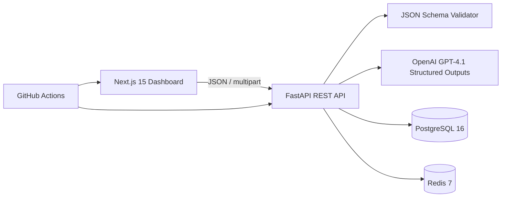

# API Test AI

API Test AI is a multi-tenant SaaS starter for importing OpenAPI documents, validating JSON payloads against JSON Schema, producing schema-based repair suggestions, generating starter test cases, and inspecting API quality from a dashboard. The repository is an executable MVP foundation, **not a security-audited production service**; production hardening items are listed below.

## Deploy the Streamlit edition

The repository includes a separate Streamlit Community Cloud-compatible interface. In Streamlit Cloud, select this GitHub repository and set **Main file path** to `streamlit_app.py` (at the repository root). Streamlit installs its Python packages from the root `requirements.txt`.

The Streamlit edition imports OpenAPI JSON/YAML, browses operations, validates payloads locally, and suggests schema-based repairs. For GPT-backed repair, deploy the FastAPI service separately and add `API_BASE_URL` in the Streamlit app's Secrets, pointing to the secured API base URL (for example, `https://your-api.example.com`). Do not put OpenAI API keys in Streamlit app code or expose them to the browser. Streamlit Cloud does not host the Next.js UI, PostgreSQL, or Redis services; use the Docker Compose/production deployment paths below for the complete stack.

## Architecture



The code is separated into API routes, core configuration/security helpers, and domain services. Tenant scoping is represented in the relational schema; repositories and transaction services should be introduced as persistence-backed use cases are implemented. Keep AI and external network calls behind service boundaries, validate uploads, and never treat generated test data as trusted input.

## Folder structure

```text
apps/
  api/
    app/
      api/routes.py          # Validation, repair, OpenAPI import, test generation
      core/config.py         # Environment configuration
      core/security.py       # JWT principal and RBAC dependencies
      services/ai.py         # OpenAI structured-output repair + local fallback
      services/openapi.py    # OpenAPI operation extraction
      services/validation.py # JSON Schema validation and explanations
    Dockerfile
    requirements.txt
  web/
    app/page.tsx             # Dashboard and interactive validation playground
    app/globals.css
    Dockerfile
infra/schema.sql             # Tenant-aware PostgreSQL baseline
streamlit_app.py             # Streamlit Community Cloud entry point
requirements.txt             # Streamlit Cloud Python dependencies
.github/workflows/ci.yml
.env.example
docker-compose.yml
```

## Database schema

`infra/schema.sql` defines `tenants`, `users`, `memberships` (owner/admin/editor/viewer RBAC), `api_specs`, `endpoints`, `test_runs`, `test_cases`, `api_keys` (hashed key material), and append-oriented `audit_logs`. Tenant-owned entities carry `tenant_id` and useful tenant-aware indexes. Enable and enforce PostgreSQL row-level security, tenant predicates, audit retention, backups, and schema migrations before production. The SQL file is a bootstrap schema; adopt Alembic for ongoing migrations.

## API design

The interactive API is rooted at `/api/v1`; FastAPI's Swagger UI is available at `/docs`.

| Method | Path | Purpose |
| --- | --- | --- |
| GET | `/health` | Liveness check |
| POST | `/api/v1/validate` | Validate a JSON instance against supplied JSON Schema; return field paths and plain-English issues |
| POST | `/api/v1/fix` | Ask GPT-4.1 for a structured repair when configured; otherwise safely add missing required placeholders |
| POST | `/api/v1/openapi/import` | Parse uploaded OpenAPI JSON/YAML and return endpoint summaries |
| POST | `/api/v1/collections/import` | Parse and summarize a Postman Collection v2 JSON file (does not execute requests) |
| POST | `/api/v1/tests/generate` | Create basic positive and missing-required-field test cases |
| POST | `/api/v1/tests/export` | Render supplied cases as starter Jest, Playwright, REST Assured, or Postman artifacts |

Example validation body:

```json
{
  "payload": {"customerId": "CUST001", "name": "John Doe"},
  "schema": {
    "type": "object",
    "required": ["customerId", "name"],
    "properties": {"customerId": {"type": "string"}, "name": {"type": "string"}}
  }
}
```

## Dashboard wireframe

```text
┌ Sidebar: Overview / Endpoints / Test runs / Collections ───────────┐
│ Good morning, Jamie                         [Import] [New test run] │
│ [Health score] [Tests passed] [Endpoints] [Response time]          │
│ [Test activity chart                    ] [Recent test runs        ] │
│ [Endpoint health table                 ] [AI playground            ] │
└────────────────────────────────────────────────────────────────────┘
```

The dashboard is responsive and now supports OpenAPI upload, selecting imported/demo endpoints, searching endpoints (⌘/Ctrl+K), interactive activity period selection, schema validation and repair, one-endpoint test runs, and help/settings/notification dialogs. Imported endpoints and run history are kept in page memory only. Chart values and seed run rows remain demo data, not persisted measurements.

## Run locally

Requirements: Docker Desktop with Compose, or Node.js 20+ and Python 3.12+ for individual services.

1. Copy `.env.example` to `.env`. Set a unique `JWT_SECRET` and optionally `OPENAI_API_KEY`; keep `.env` out of version control.
2. Start services from the repository root with `docker compose up --build`.
3. Open the dashboard at `http://localhost:3000`, API docs at `http://localhost:8000/docs`, and liveness at `http://localhost:8000/health`.
4. To stop the stack use `docker compose down`. Add `-v` only when intentionally deleting local database/Redis data.

For frontend-only development, run `npm install` then `npm run dev` in `apps/web`. For API-only development, create a virtual environment, install `apps/api/requirements.txt`, then run `uvicorn app.main:app --reload --app-dir apps/api` from the repository root. Copy `.env.example` to `.env` first.

## Security and production notes

- JWT issuance, login, membership persistence, and API-key authentication are **not yet exposed**. `core/security.py` only contains token verification/role dependencies; do not treat the sample as complete authentication.
- Database and Redis are provisioned, but the current API MVP does not yet persist test histories or use Redis for distributed rate limiting. The in-process limiter is not suitable for horizontally scaled production.
- Restrict CORS, enforce authentication and tenant authorization on every tenant-owned operation, use short-lived rotated credentials, hash API keys, add CSRF protection where cookies are used, and apply rate quotas per tenant/key.
- Treat imported OpenAPI docs and all AI outputs as untrusted. Add upload limits, JSON/YAML parser hardening, reference resolution limits, outbound egress controls (SSRF), secret redaction, privacy/retention controls, and prompt-injection defenses.
- Configure TLS, managed PostgreSQL/Redis, encrypted backups, migration/rollback procedures, secret manager integration, observability, alerting, and incident response. Never put secrets in client-side `NEXT_PUBLIC_*` variables.

## Sample AI prompts

**Repair**: “Repair the supplied JSON instance so that it satisfies the supplied JSON Schema. Preserve valid values. Use type-appropriate placeholders only for missing values. Do not add properties outside the schema. Return the repaired instance and concise rationale.”

**Failure explanation**: “Given the operation, expected schema, redacted request/response, and validator errors, identify the most likely root cause. Separate evidence from hypotheses and propose a minimal safe correction. Do not invent API behavior.”

**Test design**: “Generate positive, negative, boundary, and security test ideas from this operation schema. Mark each expected outcome, avoid destructive external execution, and flag cases needing human review.”

## CI/CD

`.github/workflows/ci.yml` runs Python import/compile checks and a Next.js TypeScript/build check on pushes and pull requests. For deployment, extend it with unit/integration tests, dependency and image scanning, SBOM generation, signed image publishing, staging migrations, and approval-gated production rollout. Pin actions by commit SHA in security-sensitive environments.

## Production roadmap

1. **Identity & tenancy** — implement registration/invites, password hashing or SSO, verified JWT issuance, API-key creation/rotation/revocation, tenant-aware RBAC, row-level security, and audit hooks.
2. **Durable test orchestration** — repository/unit-of-work layer, Alembic migrations, persisted specs/runs, Redis-backed queues and distributed rate limits, background workers, retries, cancellation, and idempotency.
3. **Complete test workflow** — Postman collection import, safe controlled execution, response validation, report artifacts, schema-to-test exports for Postman/Jest/Playwright/REST Assured, and history filters.
4. **AI reliability** — strict output validation against operation schemas, prompt-injection defenses, token/cost budgets, tenant quotas, redaction, evaluations, human approval, and model fallback.
5. **Enterprise operations** — SSO/SCIM, billing/entitlements, regional storage, data deletion/export, SLOs, telemetry, load testing, pen testing, and disaster-recovery drills.

## License

No license has been assigned. Add an appropriate license before distributing this repository.
